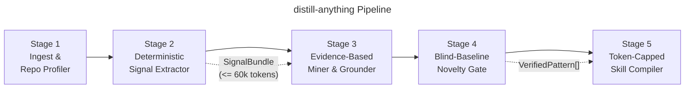

<p align="center">
  <picture>
    <source media="(prefers-color-scheme: dark)" srcset="assets/banner-dark.svg">
    <source media="(prefers-color-scheme: light)" srcset="assets/banner-light.svg">
    
  </picture>
</p>

<p align="center">
  Analyze any git repository or set of architectural findings and compile the transferable,<br>
  non-obvious engineering patterns into a token-capped Agent Skill with verbatim source citations.
</p>

<!-- Replace OWNER/REPO if the GitHub slug changes -->
<p align="center">
  <a href="LICENSE"></a>
  
  
  
  <a href="https://github.com/imMamdouhaboammar/repo-to-skill/actions"></a>
</p>

<p align="center">
  <a href="#quick-start">Quick Start</a> ·
  <a href="#how-the-5-stage-pipeline-works">How It Works</a> ·
  <a href="#workflow-b-turn-conversation-findings-into-a-verified-skill">From Findings</a> ·
  <a href="#cli-reference">CLI Reference</a> ·
  <a href="#architecture">Architecture</a>
</p>

---

## Immediate Visual Proof

```text
$ distill-anything https://github.com/example/ring-buffer --name ring-buffer

[distill-anything] Using Codex CLI (1.0.7) · model=gpt-5.4 · reasoning=medium
[distill-anything] Ingesting https://github.com/example/ring-buffer...
[distill-anything] Extracting deterministic signals (AST + Git + Tests)...
[distill-anything] Mining patterns with codex:gpt-5.4...
[distill-anything] Running Novelty Gate across 6 patterns (min-novelty=4)...

  Skill compiled -> .claude/skills/ring-buffer/

  ring-buffer/
  ├── SKILL.md                     # <= 1,200 tokens
  ├── distill-report.json          # provenance, costs, dropped patterns
  └── references/
      └── patterns/
          ├── 01-lock-free-spsc.md  # <= 900 tokens each
          ├── 02-cache-line-pad.md
          └── 03-batch-drain.md

  Patterns kept: 3 | Dropped: 3 (2 grounder, 1 novelty < 4)
  Total cost: $0.42
```

> [!NOTE]
> `distill-anything` discovers and runs your local **Codex CLI** (`codex`) by default. On first run without a saved config, it launches interactive model and reasoning setup (`distill-anything config`). You can also pass `--model <provider>:<model>` to use Anthropic (`anthropic:claude-sonnet-4-5`), OpenAI (`openai:gpt-4.1`), Google (`google:gemini-2.5-pro`), or Vertex AI via `gcloud` (`gcloud:gemini-2.5-pro`).

---

## Why Distill Anything

| Dimension | Distill Anything | Library/CLI Skill Generators | Repo Packers (Repomix) | In-Repo Wikis (DeepWiki) |
| :--- | :--- | :--- | :--- | :--- |
| **Primary Output** | Token-capped Agent Skill (`SKILL.md` + pattern files + audit report) | Flat `SKILL.md` or rules file | Single packed context file | Hosted documentation pages |
| **Deterministic AST/Git Filtering** | Yes. Fan-in graph + git diff keyword scoring, zero LLM calls in Stages 1-2 | Partial or none | File concatenation only | No |
| **Verbatim Disk Grounding** | Sliding-window grounder verifies every citation against actual file lines | No verification | N/A (raw dump) | No verification |
| **Blind Novelty Gate** | Blind baseline + head-to-head judge; drops patterns scoring below threshold | No | No | No |
| **Anti-Trigger Restraint** | Every pattern requires concrete anti-triggers; A/B eval penalizes cargo-culting | Rarely present | N/A | No |
| **Context Window Cap** | Hard caps: `SKILL.md` <= 1,200 tokens, each pattern <= 900 tokens | Uncapped or manually trimmed | Uncapped | Uncapped |

---

## Quick Start

> [!IMPORTANT]
> **Prerequisites**: [Bun](https://bun.sh) >= 1.2.0, Git, and one of the following:
> - **Codex CLI** installed and authenticated (`codex login`), or
> - An API key for another provider (`ANTHROPIC_API_KEY`, `OPENAI_API_KEY`, `GOOGLE_GENERATIVE_AI_API_KEY`), or
> - `gcloud` CLI authenticated for Vertex AI.

**Install from source:**

```bash
git clone https://github.com/imMamdouhaboammar/repo-to-skill.git
cd repo-to-skill
bun install
```

**Configure default model and reasoning (interactive, one-time):**

```bash
bun run distill config
```

This saves your preferences to `~/.config/distill-anything/config.json`. You can override per-run with `--model` and `--reasoning`.

**Inspect before spending tokens (dry run):**

```bash
bun run distill https://github.com/example/some-repo --dry-run
```

The `--dry-run` flag runs only Stages 1 (Ingest) and 2 (Signal Extraction), printing the `SignalBundle` statistics and estimated USD cost without making any LLM calls.

**Full distillation:**

```bash
bun run distill https://github.com/example/some-repo
```

**Compile to a standalone binary:**

```bash
bun run build:bin
# produces dist/distill-anything
```

---

## Workflow A: Distill Any Repository

```bash
# Remote repository
distill-anything https://github.com/tokio-rs/tokio --name tokio-internals

# Local directory
distill-anything ./my-project --subpath packages/core

# Custom output directory and model
distill-anything ./my-project \
  --out .agents/skills \
  --model anthropic:claude-sonnet-4-5 \
  --judge-model openai:gpt-4.1-mini
```

For monorepos, use `--subpath` to restrict analysis to a specific package. The output lands in `<--out>/<skill-slug>/` (default: `.claude/skills/<skill-slug>/`).

---

## Workflow B: Turn Conversation Findings into a Verified Skill

If you have architectural notes from a code review session, debugging transcript, or design discussion, `from-findings` structures them into a grounded skill:

```bash
distill-anything from-findings ./notes/session-findings.md \
  --repo https://github.com/example/the-repo \
  --name session-patterns \
  --out .claude/skills
```

The `--repo` flag provides the repository for deterministic snippet grounding. Without it, pass `--allow-ungrounded` (output is marked `evidence: ungrounded_notes`).

The default `--min-novelty` for `from-findings` is `3` (versus `4` for full repo distillation), since conversation findings tend to be pre-filtered by the engineer.

**Installing the `distill-anything` meta-skill for coding agents:**

```bash
bun run install:skill
```

This symlinks `skills/distill-anything/` into `~/.claude/skills/distill-anything` and `~/.agents/skills/distill-anything`, so agents like Claude Code and Codex automatically route prompts like "turn these findings into a skill" or "distill this repo" through the grounding and novelty pipeline instead of hallucinating a `SKILL.md` from chat memory.

---

## How the 5-Stage Pipeline Works



**Stage 1: Ingest and Repo Profiler** (`src/stages/01-ingest.ts`).
Clones remote repositories (shallow, `--depth 150`, `--filter=blob:none`), detects languages, computes a deterministic `MaturityProfile` (CI presence, test ratio, experimental markers), and excludes generated/vendored/binary files. Zero LLM calls.

**Stage 2: Deterministic Signal Extractor** (`src/stages/02-signals/`).
Parses source files with `web-tree-sitter` WASM grammars to build an import-graph and compute fan-in centrality scores. Splits a 60,000-token budget across four buckets: core architecture files (30k), high-signal git diffs (15k), edge-case tests (10k), and architectural docs (5k). Unused tokens roll over into the core bucket. Every file is emitted with 1-indexed line numbers so Stage 3 citations can be verified deterministically. Zero LLM calls.

**Stage 3: Evidence-Based Miner and Disk Grounder** (`src/stages/03-miner/`).
Sends the `SignalBundle` to the primary model with strict instructions: extract only concrete patterns with exact file paths and line ranges, tag evidence as `seen_explicit` or `inferred_from_code`, and require at least two anti-triggers per pattern. A deterministic grounder then verifies every citation against disk: it reads the actual lines, computes overlap, and runs a sliding-window search to correct off-by-N drift. Patterns that lose all valid citations are dropped; if more than 50% fail grounding, Stage 3 retries once and exits with code `5` on repeated failure.

**Stage 4: Blind-Baseline Novelty Gate** (`src/stages/04-novelty/`).
For each grounded pattern, the judge model receives only the problem statement and language (no repo name, no snippets) and writes a blind baseline solution. A second judge call compares the baseline against the candidate on a 1-5 rubric. Patterns scoring below `--min-novelty` (default: `4` for repos, `3` for findings), with transferability below 3, or with weak anti-triggers are dropped. Runs in parallel with concurrency limit 4.

**Stage 5: Token-Capped Skill Compiler** (`src/stages/05-compiler/`).
Renders `SKILL.md` (hard cap: 1,200 tokens) with a progressive-disclosure decision table (trigger and anti-trigger columns), individual `references/patterns/*.md` files (hard cap: 900 tokens each), and `distill-report.json` with full provenance, cost breakdown, and dropped-pattern audit log. Zero LLM calls.

---

<details>
<summary><strong>Inspect a sample generated SKILL.md and pattern file</strong></summary>

**SKILL.md** (progressive-disclosure decision table):

```markdown
---
name: ring-buffer
description: Engineering playbook distilled from ring-buffer (rust, production).
  Use when designing or reviewing lock-free queues, cache-line alignment,
  or batch-drain strategies where sub-microsecond latency is required.
---

# ring-buffer Engineering Playbook

- **Source**: `https://github.com/example/ring-buffer` @ `a1b2c3d`
- **Maturity**: `production`
- **Operating Context**: Lock-free SPSC queue, cache-line padding, batch drain

## Pattern Decision Table
Load a pattern file ONLY when the trigger condition matches AND no anti-trigger applies.

| Pattern | Category | Load When (Trigger) | Skip When (Anti-Trigger) | Reference |
| :--- | :--- | :--- | :--- | :--- |
| Lock-Free SPSC Ring | `concurrency` | Designing single-producer single-consumer queue with <= 1us latency | Multi-producer or unbounded queue acceptable | [01-lock-free-spsc.md](references/patterns/01-lock-free-spsc.md) |
| Cache-Line Padding | `memory_layout` | Shared-memory struct with producer/consumer on separate cores | Single-threaded or L1-resident working set | [02-cache-line-pad.md](references/patterns/02-cache-line-pad.md) |
| Batch Drain Strategy | `throughput` | Consumer processes items in bursts under backpressure | Latency-critical single-item processing required | [03-batch-drain.md](references/patterns/03-batch-drain.md) |

## Quick Transferable Rules
- **Lock-Free SPSC Ring**: Use atomic load/store with Acquire/Release ordering on head/tail indices; avoid CAS loops for single-producer.
- **Cache-Line Padding**: Pad head and tail indices to separate 64-byte cache lines to eliminate false sharing.
- **Batch Drain Strategy**: Snapshot the tail index once, then drain all items up to the snapshot without re-reading the atomic.
```

**references/patterns/01-lock-free-spsc.md** (verbatim-cited pattern):

```markdown
# Lock-Free SPSC Ring

- **Category**: `concurrency`
- **Maturity**: `production_proven`
- **Evidence**: `seen_explicit`
- **Novelty Audit**: `5/5` (Transferability: `4/5`)

## Problem
Standard `Mutex<VecDeque>` queues add 200-800ns of contention overhead per enqueue/dequeue
under sustained throughput on multi-core systems.

## Default Approach (And Why It Breaks)
Wrapping a VecDeque in a Mutex serializes all access. Under high throughput,
lock contention dominates and tail latency spikes above 10us at p99.

## Repository Pattern
Fixed-capacity ring buffer with separate atomic head (consumer) and tail (producer) indices.
Producer writes data then publishes tail with Release store. Consumer reads head,
loads tail with Acquire, and drains without any CAS or lock.

## Verified Source Evidence
**`src/ring.rs` (Lines 42-58)** · Commit `a1b2c3d`
` ` `rust
pub fn push(&self, item: T) -> Result<(), T> {
    let tail = self.tail.load(Ordering::Relaxed);
    let next = (tail + 1) % self.capacity;
    if next == self.head.load(Ordering::Acquire) {
        return Err(item); // full
    }
    unsafe { self.buffer.add(tail).write(item) };
    self.tail.store(next, Ordering::Release);
    Ok(())
}
` ` `

## Trade-Offs
* Fixed capacity requires pre-allocation; cannot grow dynamically.
* Only correct for exactly one producer and one consumer thread.

## When to Apply
* Single-producer, single-consumer queue with sub-microsecond latency target.
* Bounded memory footprint is acceptable or required.

## Anti-Triggers (Do NOT Apply When)
* Multiple producers or consumers exist (use MPMC queue instead).
* Unbounded growth is required (use a lock-free linked list or channel).
```

</details>

---

## CLI Reference

<details>
<summary><strong>Subcommands, flags, environment variables, and exit codes</strong></summary>

### Subcommands

| Command | Description |
| :--- | :--- |
| `distill-anything <source>` | Distill a local path or Git URL into an Agent Skill. |
| `distill-anything from-findings <findings-file>` | Structure existing findings (Markdown, text, or JSON) into a verified skill. |
| `distill-anything config` | Interactively configure default Codex CLI model and reasoning effort. |

### Flags: `distill-anything <source>`

| Flag | Type | Default | Description |
| :--- | :--- | :--- | :--- |
| `--out <dir>` | string | `./.claude/skills` | Output directory. |
| `--name <slug>` | string | Auto-derived | Override skill folder name (kebab-case). |
| `--subpath <path>` | string | `.` | Restrict to a monorepo package. |
| `--model <id>` | string | `codex:<saved>` | Primary model for Stage 3 mining. |
| `--judge-model <id>` | string | `codex:<saved>` | Model for Stage 4 novelty judging. |
| `--reasoning <effort>` | enum | Saved config | Override reasoning: `low`, `medium`, `high`, `xhigh`. |
| `--judge-reasoning <effort>` | enum | Saved config | Override judge reasoning effort. |
| `--reconfigure` | flag | `false` | Re-run interactive Codex setup before executing. |
| `--max-budget <usd>` | number | `2.00` | Hard USD cap. Aborts gracefully on breach (exit 3). |
| `--max-files <n>` | number | `20` | Maximum source files in SignalBundle. |
| `--max-commits <n>` | number | `15` | Maximum high-signal git diffs in SignalBundle. |
| `--git-depth <n>` | number | `150` | Shallow clone depth for remote repos. |
| `--min-novelty <1-5>` | number | `4` | Minimum novelty score to keep a pattern. |
| `--skip-novelty` | flag | `false` | Bypass Stage 4 (marks output unverified). |
| `--dry-run` | flag | `false` | Run Stages 1 and 2 only; print stats and cost estimate. |
| `--no-git` | flag | `false` | Skip git history mining. |
| `--json` | flag | `false` | Emit machine-readable report to stdout. |

### Flags: `distill-anything from-findings <findings-file>`

| Flag | Type | Default | Description |
| :--- | :--- | :--- | :--- |
| `--repo <source>` | string | None | Repository for deterministic snippet grounding. |
| `--allow-ungrounded` | flag | `false` | Allow skipping disk grounding (marks output `ungrounded_notes`). |
| `--min-novelty <1-5>` | number | `3` | Minimum novelty score (lower default for pre-filtered findings). |

All shared flags (`--out`, `--name`, `--subpath`, `--model`, `--judge-model`, `--reasoning`, `--judge-reasoning`, `--reconfigure`, `--max-budget`, `--git-depth`, `--skip-novelty`, `--no-git`, `--json`) also apply.

### Flags: `distill-anything config`

| Flag | Type | Default | Description |
| :--- | :--- | :--- | :--- |
| `--json` | flag | `false` | Emit saved configuration as JSON to stdout. |

### Environment Variables

| Variable | Description |
| :--- | :--- |
| `DISTILL_CODEX_PATH` | Override path to the `codex` binary. |
| `DISTILL_CONFIG_PATH` | Override config file path (default: `~/.config/distill-anything/config.json`). |
| `DISTILL_MODEL` | Default model for non-interactive (non-TTY) environments. |
| `DISTILL_REASONING` | Default reasoning effort for non-interactive environments. |
| `DISTILL_PRICING_JSON` | JSON override for per-model token pricing (merged with built-in defaults). |
| `ANTHROPIC_API_KEY` | API key when using `--model anthropic:<model>`. |
| `OPENAI_API_KEY` | API key when using `--model openai:<model>`. |
| `GOOGLE_GENERATIVE_AI_API_KEY` | API key when using `--model google:<model>`. |

### Exit Codes

| Code | Meaning |
| :--- | :--- |
| `0` | Skill compiled and verified. |
| `1` | General runtime or I/O error. |
| `2` | Invalid CLI arguments or missing API key / Codex CLI. |
| `3` | Budget cap (`--max-budget`) reached before completion. |
| `4` | Zero patterns survived the Novelty Gate. |
| `5` | Grounding failure (LLM repeatedly produced unverifiable file paths or line ranges). |

</details>

---

## Architecture

```text
distill-anything/
├── bin/
│   └── distill-anything.ts           # CLI entrypoint (shebang: #!/usr/bin/env bun)
├── grammars/                          # Bundled tree-sitter WASM grammars
│   ├── tree-sitter-typescript.wasm
│   ├── tree-sitter-python.wasm
│   ├── tree-sitter-rust.wasm
│   ├── tree-sitter-go.wasm
│   └── tree-sitter-cpp.wasm
├── prompts/                           # Externalized prompt templates
│   ├── miner-system.md
│   ├── miner-user.md
│   ├── novelty-baseline.md
│   └── novelty-judge.md
├── skills/
│   └── distill-anything/SKILL.md      # Meta-skill for coding agent integration
├── src/
│   ├── cli/
│   │   ├── args.ts                    # Commander flag definitions + Zod validation
│   │   ├── reporter.ts                # Terminal progress and cost display
│   │   └── setup.ts                   # Interactive Codex model/reasoning setup
│   ├── core/
│   │   ├── budget.ts                  # Real-time USD and token ledger
│   │   ├── codex-discovery.ts         # Codex CLI discovery + ~/.codex/config.toml reader
│   │   ├── config.ts                  # Persistent config (~/.config/distill-anything/)
│   │   ├── llm.ts                     # Provider wrapper (Codex, Anthropic, OpenAI, Google, Vertex)
│   │   └── tokens.ts                  # Token counting and truncation
│   ├── schemas/                       # Zod schemas for all pipeline data
│   ├── stages/
│   │   ├── 01-ingest.ts               # Clone, profile, noise exclusion
│   │   ├── 02-signals/                # AST graph, git miner, test hunter, bundler
│   │   ├── 03-miner/                  # LLM extraction + deterministic grounder
│   │   ├── 04-novelty/                # Blind baseline + head-to-head judge
│   │   └── 05-compiler/               # Render SKILL.md + pattern files
│   └── eval/
│       ├── harness.ts                 # A/B evaluation task schema
│       └── runner.ts                  # Control vs Treatment runner
└── tests/
```

---

## Verification and Testing

```bash
# Type-check
bun run typecheck

# Run unit tests
bun test

# Compile standalone binary
bun run build:bin
```

The A/B evaluation harness (`src/eval/runner.ts`) runs Control (no skill) versus Treatment (skill injected) trials against positive and negative (anti-trigger) tasks. A skill passes ship criteria when Treatment beats Control on >= 2/3 positive tasks and passes all negative anti-trigger tasks with zero cargo-culting.

---

## Contributing

1. Fork the repository and create a feature branch.
2. Run `bun run typecheck && bun test` before submitting.
3. Follow the existing code style (strict TypeScript, Zod schemas for all data boundaries).
4. Open a pull request with a clear description of what changed and why.

---

## License

[MIT](LICENSE)
